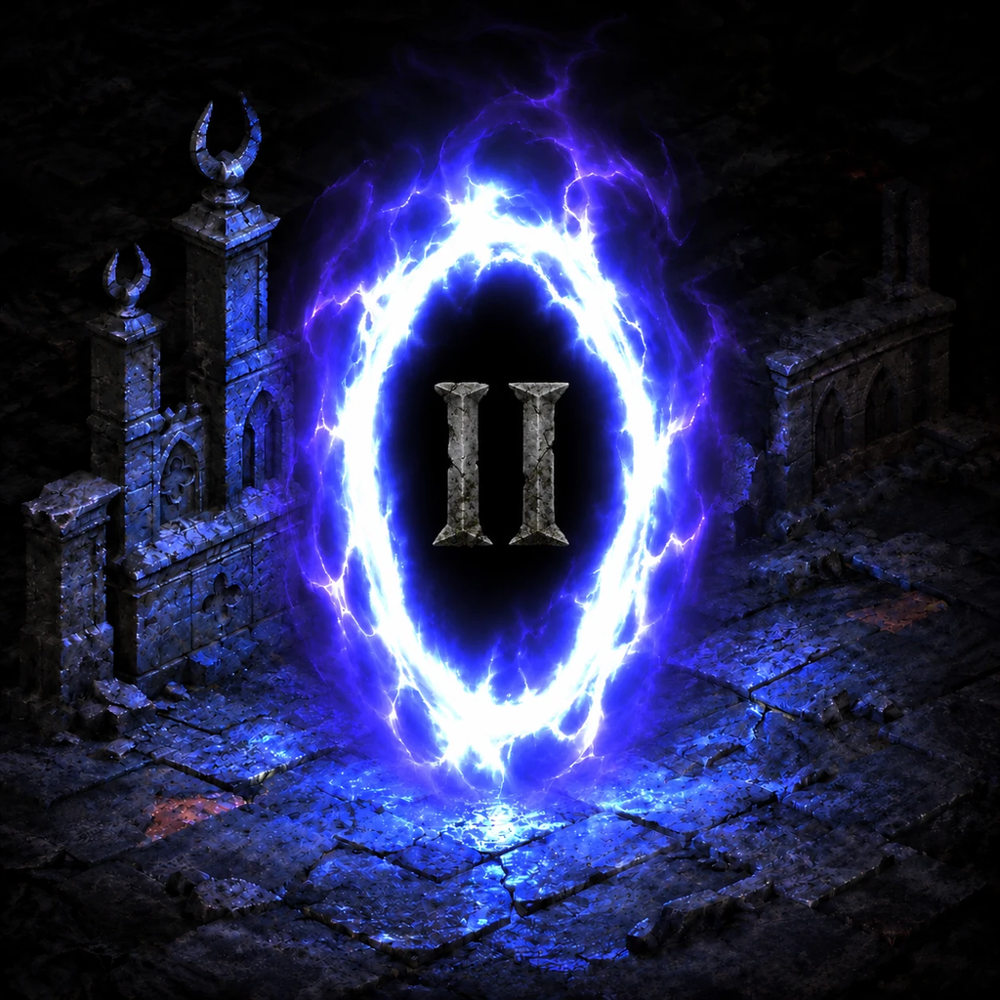

<p align="center"></p>

# D2R-Rakanishu

Diablo II: Resurrected on Android, with the extras I kept wishing the game had.

This is a fork of [d2r-mobile](https://github.com/jhaizhou-ops/d2r-mobile) by jhaizhou. They did the hard part. Their port runs the game's own ARM64 program on the phone and draws it with Vulkan, and the touch controls, endgame modes and farming helpers come from them too. I started playing it on my phone and then kept adding things. Most of them answer questions I had while playing. Can my character take the next boss? Is this ring actually better? Why does this helm look so bad?

You need your own copy of the game. The APK contains none of its files, and everything runs offline.

## What I added

### Transmog at Charsi

Bring Charsi her hammer back and she will change how your gear looks. Pick any identified item of the same kind that you have owned, preview it on your character and pay in gold. You can also hide your helm or shield. The real items in your save stay as they are; the looks are kept in a separate file next to it. Each difficulty unlocks this again with its own hammer quest.

### Dye with gems

Gems in your inventory turn into colours in the same tab. Dyeing an item uses up one gem of that colour.

### Combat simulation

Before I walk into Andariel I want to know if I will come back out. The combat page simulates the next main boss, the mini bosses of the act and any other monster against your character as it is right now. You get the time to kill, the time until you die and a rating, and the numbers update when you change gear or skills. Open a fight to see how it plays out.

### Best gear

This searches everything you carry and store (worn gear, inventory, every personal stash page and the shared tabs) and finds the best combination for your goal. You say how many hits you want to survive and how much boss damage matters compared to clearing groups. The search is exact. With the stash open, one tap puts on a single item or the whole set. Items with auras, item skills or charges are left out for now.

### Your real DPS

The fight log measures your own damage per second over your last 50 fights with your current gear and skills, shows the range, and splits it between your skills, your mercenary and your summons. Solo kills are compared with what the simulation expected. A curve shows how your DPS changed over time, with a marker wherever you changed gear, levelled up or spent points.

### Melee splash (optional)

Melee hits also hit the enemies in a cone in front of you. How much they take depends on your weapon, your class and your strength, and each of those hits shows its own damage number.

### Shrine stacking (optional)

Shrines no longer replace each other. Each one keeps its own timer, picking up the same shrine again adds to its time, and the symbols sit next to each other above your head. The stamina shrine can also make you run and walk 50 % faster.

### Item comparison in the tooltip

When you look at an item, the tooltip also tells you what it would change for your character. Resistances show up as how much less damage you take, attack and cast speed as animation frames, and you see the difference in life, block chance and skill levels (skill tab bonuses included). At the bottom is the combat simulation's verdict.

### Fight log

Each character keeps its last 50 fights, also across sessions. Every fight has a graph of your life during the fight, and where the simulation can compare, its version of the fight is drawn on top.

### Kill streak (optional)

A small counter above the action bar. Keep hitting things to keep it going, climb through the tier titles, and get bonus experience when the streak ends.

### Build guides, recipe book and glossary

There are 28 build guides with skill and stat plans. The cube recipe book is searchable and knows which recipes your stash can make right now. The glossary explains game mechanics using your character's current values.

### Smaller things

Most of the gameplay changes can be turned off on the Extras page. The pages I added use the game's own art and fonts, loaded from your files when the app starts.

The Video tab lets you install and pick a different Vulkan driver, for example Turnip. My phone had flickering stripes with its system driver, and a newer driver fixed them. The same tab has sliders for resolution, frame rate and 3D quality, and a picture preset that sets resolution and 3D sharpness in one go, up to the full screen resolution.

The added pages work with a controller. You can map the phone's shoulder triggers, see status effects with their remaining time, and keep a clock, battery and frame rate line on screen.

The game saves every minute, when you leave the app and after stash actions. It pauses in the background instead of being closed. If Android closes it anyway while you are out in the field, the game starts in town as usual and offers to take you back to where you were.

From upstream, with thanks to jhaizhou and the people around the community port: the ARM64 and Vulkan runtime, touch and controller controls, Greater Rift, Boss Rush, Elysium mode and the Kill Board, the Chronicle stash, Trove and Pouch, auto-recast, auto-potions, the loot filter, auto-pickup, the runeword helper, save export and import, and the home screen widgets.

## Install and build

- [Install the APK and copy your import pack](#install)
- [Build your import pack from your own game files](#build-your-import-pack)
- [Saves and switching from d2r-mobile](#saves-and-switching-from-d2r-mobile)
- [Build the APK](#build-the-apk)

## Install

You need an ARM64 phone with Android 12 or newer and Vulkan 1.1. I can't promise it runs on every phone that meets that, since GPUs differ a lot.

1. Download the `player` APK from the release and check it against the SHA-256 checksum next to it.
2. Install it and allow access to all files when asked. The application ID is `io.r4k4n1shu.d2r`.
3. Build the import pack from your own game files (see below).
4. Copy the pack and the resource directory like this:

```text
Download/S2X/D2R Mobile/
  data/                    <- the complete RomFS/data directory
  r4k4n1shu/
    android/               <- the complete import pack
      pack_info.txt
      out/
      shaders/
      overlay/
      ...
```

Then open the app and let the import finish. The pack has to match the APK's product code. The big resource archives stay in the shared `data/` folder, and the app only copies the much smaller pack into its own storage. Back up your saves before you upgrade or uninstall.

If you already have a matching pack in the old shared `android/` folder, the app moves it to `r4k4n1shu/`, or reads it where it is if moving fails. A pack in the new place always wins, and the game archives are never copied twice.

## Build your import pack

The supported input is the Switch version 3.3.94012 with `Update/ExeFS/` and `Update/RomFS/data/`, taken from your own copy of the game. The upstream docs in `docs/d2r-mobile/` explain how to get them. This project does not provide game files.

You need Python 3.9 or newer with `pillow numpy lz4 capstone unicorn`, the .NET SDK, and the Vulkan tools `spirv-opt`, `spirv-val` and `glslc`. The pack tool tells you if something is missing. From the source tree of the release:

```sh
python3 dm/tools/d2rm_android.py /path/to/Update /path/to/private-pack
```

This creates `/path/to/private-pack/android/`, which you copy as shown above. The pack contains game content, so keep it private and out of any repository. When the native patch tools or overlay layouts change, you have to rebuild the pack, because a new APK alone can't update those parts.

## Saves and switching from d2r-mobile

Export and Import are on the app's technical page. You can also do it by hand in `Download/S2X/D2R Mobile/r4k4n1shu/`. An empty file named `export` makes the app export to `save-export/<stamp>/`, and a folder named `save-import/` is imported on the next start.

Coming from an upstream version that can export: export there first, copy the contents of its `save-export/<stamp>/` into our `r4k4n1shu/save-import/`, and start this app. Keep the original export as a backup. Both apps share the game archives, but saves, packs and transfer markers are separate. Check your characters, shared stash and settings before you remove the old app.

## Build the APK

You need JDK 17 or newer, Gradle 9.8.1, Android SDK 36, NDK 29.0.14206865 and CMake 3.31.6. Point `JAVA_HOME`, `ANDROID_HOME`, `DM_ROMFS_SRC` and `DM_PYTHON` at your installation and game files. More in the [Android build details](dm/android/README.md).

```sh
dm/android/tools/shell_apk.sh -PdmVariant=qa
dm/android/tools/shell_apk.sh release -PdmVariant=player
```

The APKs end up in `${DM_ROOT:-$HOME/dm-work}/build/android_shell/` as `D2RMobile-android.apk` and `D2RMobile-android-player.apk`. The qa build has the test tools and is debuggable in debug mode. The player build has no test controls and is never debuggable. Both are signed with the same key.

Create your signing key yourself and keep it outside the repository. Put its settings in `~/.config/d2r-release/signing.properties`:

```properties
storeFile=/private/path/release.keystore
storeType=PKCS12
keyAlias=release
storePassword=your-store-password
keyPassword=your-key-password
```

A different path can be given with `-PdmSigningProperties=/private/path/signing.properties` or `DM_SIGNING_PROPERTIES`. The environment variables `DM_ANDROID_KEYSTORE`, `DM_ANDROID_STORE_TYPE`, `DM_ANDROID_KEY_ALIAS`, `DM_ANDROID_STORE_PASSWORD` and `DM_ANDROID_KEY_PASSWORD` override the file. A relative keystore path is read relative to the properties file.

Without a release key, qa debug builds fall back to the Android debug key and print a warning. Release and player builds stop instead, unless you allow the debug key for local testing with `-PdmAllowDebugSigning=true` or `DM_ALLOW_DEBUG_SIGNING=1`. Don't publish an APK signed with the debug key. The scripts never create a key; a missing debug key or an incomplete release setup stops the build. The old `~/.config/dm-android/release.env` is no longer read, so move its settings to the properties file or the variables above.

Use the same key for qa and player if one should replace the other. Player builds don't allow `adb run-as`, so move private data with a qa build signed with the same key before you install the player build.

## Credits and license

Based on [d2r-mobile](https://github.com/jhaizhou-ops/d2r-mobile) by jhaizhou. Thanks to biglawine for the HarmonyOS port and to everyone who contributed upstream.

The [MIT license](LICENSE) is unchanged, and third-party components keep their own licenses. Diablo II: Resurrected and its content belong to their owners and are not part of this project.

The original upstream READMEs and contribution guides are kept unchanged in [docs/d2r-mobile/](docs/d2r-mobile/README.md). Their relative links refer to the upstream layout.
